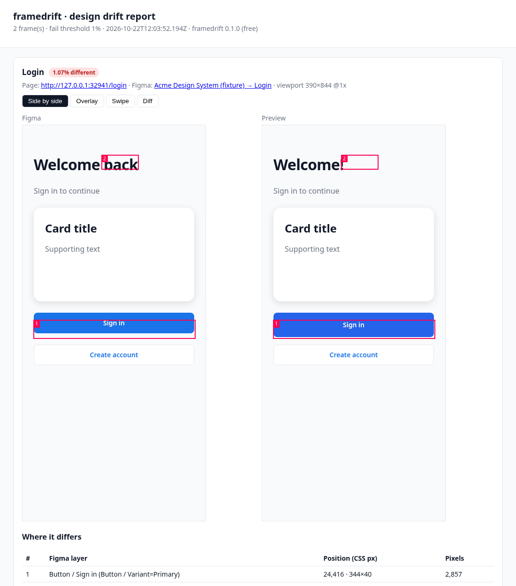

# framedrift

**Checks every PR's Vercel preview against its Figma frame, in CI.** When Vercel finishes a preview deployment, framedrift opens the page in headless Chrome, renders the Figma frame it was built from, diffs the two, and posts one comment on the pull request listing what drifted — by Figma layer name.



<sub>Screenshot from framedrift's own end-to-end test (a fixture design vs. a page with a taller, re-coloured button and changed title). Not a customer project.</sub>

- **GitHub Action** — runs on Vercel's `deployment_status` event, posts one PR comment (updated on every push), uploads the full visual report.
- **CLI** — `npx framedrift compare --url … --figma …` against any URL: preview, staging, localhost.
- **Names what drifted** — each differing region is matched to the Figma layer it falls on, e.g. `Button / Sign in (Button / Variant=Primary)`.
- **Report** — side-by-side, overlay, swipe and diff views in a single offline HTML file.
- **Nothing to host.** Your Figma token and preview stay in your CI. framedrift has no server; the only network calls are to Figma, your preview, GitHub, and (Pro only) a license check.

> **Install note:** the npm package is on its way. Until it lands, swap `npx framedrift` for `npx github:sherzodmax/framedrift` in the commands below. The GitHub Action (`uses: sherzodmax/framedrift@v0`) works today.

Try it without a Figma token (runs on a built-in fixture page; needs Chrome or `npx playwright install chromium`):

```bash
npx framedrift demo && open framedrift-report/index.html
```

> Status: **0.1.2, early.** The CLI and Action are tested end-to-end against real pages and a mocked Figma API. Testing against the live Figma API with real projects is the next step — please open an issue if something looks off.

## Why another design-QA tool?

The design-QA tools I could find — [Pixelay](https://hypermatic.com/pixelay), [DualCheck](https://dualcheck.io), [inspecta](https://inspecta.design), [OverlayQA](https://overlayqa.com) — work through a browser extension or Figma plugin: someone opens them on a live page and checks it. They're good at that (OverlayQA also files issues to GitHub, Jira and others). As far as I can tell from their sites (Oct 2026), none of them runs as an automatic check on each pull request. framedrift is for the part that gets skipped: it runs automatically on **every PR**, against the actual preview deployment, and puts the result where the code review already happens.

| | framedrift | Extension / plugin tools (Pixelay, DualCheck, inspecta, OverlayQA) | CI visual testing (Chromatic, Percy) |
|---|---|---|---|
| Compares against | the Figma frame | the Figma frame | an earlier screenshot of your app |
| Runs | automatically on every PR | when someone opens it | automatically on every PR |
| Where results show up | PR comment + report artifact | in the browser / Figma / their app | their dashboard + PR status |
| Price (as listed on their sites, Oct 2026) | free (MIT), Pro $12/mo per repo | ~$8–39/mo | free tiers; paid plans ~$149+/mo |

Extensions are better for interactive, pixel-by-pixel inspection by a designer; Chromatic/Percy are better at catching regressions against your own baseline. framedrift answers a narrower question: *does this PR still look like the design?*

## Quick start (CLI)

```bash
# Node 22+. Uses an installed Chrome/Chromium, or: npx playwright install chromium
export FIGMA_TOKEN=figd_...            # Figma → Settings → Security → Personal access tokens (File content: Read)
npx framedrift compare \
  --url https://my-app-git-feature-x.vercel.app/login \
  --figma "https://www.figma.com/design/AbC123/App?node-id=20-1"
open framedrift-report/index.html
```

The Figma link must point at a frame — in Figma right-click it → **Copy/Paste as → Copy link to selection**. The page is captured at the frame's width (and height, or `--viewport-height` for long pages), at `--scale` 1 by default.

No Figma file handy? Compare against any PNG:

```bash
npx framedrift compare --url https://example.com --design ./mockup.png --fail-on 1
```

### Useful options

| Option | What it does |
|---|---|
| `--hide ".cookie-banner"` | Hide dynamic elements before capture (repeatable) |
| `--wait-for "main"` | Wait for a selector before capture |
| `--selector "#hero"` | Compare one element/component instead of the page |
| `--viewport 1440x900` | Override the viewport (default: frame size) |
| `--threshold 0.1` | Per-pixel color tolerance (0–1). Raise it if anti-aliasing is noisy |
| `--fail-on 2` | Exit code 1 when more than 2% of pixels differ |
| `--vercel-bypass $SECRET` | Vercel Deployment Protection bypass (or `VERCEL_AUTOMATION_BYPASS_SECRET`) |
| `--vercel-project my-app` / `--vercel-team acme` | The bypass secret only goes to that project's preview URLs (`my-app-<9-char hash>-acme.vercel.app`, `my-app-git-<branch>-acme.vercel.app`; env `FRAMEDRIFT_VERCEL_PROJECT` / `FRAMEDRIFT_VERCEL_TEAM`). `--vercel-team` is required with a bypass secret. Without them (and without `--preview-host`) any `*.vercel.app` host may get it, with a warning |
| `--preview-host preview.example.com` | Host the bypass secret may go to (repeatable; replaces the default above; `*` inside a label matches one label). With a bypass secret, the URL must also be `https` on port 443 |
| `--header "Cookie: …"` | Extra request headers (repeatable). Like the bypass secret, they are sent only to the preview's own origin |
| `--json` | Machine-readable result on stdout |

Exit codes: `0` ok · `1` drift above `--fail-on` · `2` usage/config error (missing token, bad option or config values) · `3` runtime error: any frame failed to compare (preview unreachable or HTTP 4xx/5xx, Figma API error), even if other frames were clean.

Troubleshooting common errors (unreachable preview, 403 from Figma, rate limits, size mismatches): [docs/troubleshooting.md](docs/troubleshooting.md).

## Many pages: `.framedrift.json`

```json
{
  "defaults": { "failOn": 2, "hide": [".cookie-banner"], "waitFor": "main" },
  "frames": [
    { "name": "Login",   "path": "/login",   "figma": "https://www.figma.com/design/AbC123/App?node-id=20-1" },
    { "name": "Pricing", "path": "/pricing", "figma": "https://www.figma.com/design/AbC123/App?node-id=31-7", "viewportHeight": 900 },
    { "name": "Button",  "path": "/storybook/button", "selector": "#root button", "figma": "https://www.figma.com/design/AbC123/App?node-id=10-1", "failOn": 1 }
  ]
}
```

```bash
npx framedrift run --base-url https://my-app-git-feature-x.vercel.app
```

Per-frame keys: `name`, `path`, `figma` or `design` (a PNG path relative to the config file), `selector`, `hide`, `waitFor`, `delayMs`, `viewportHeight`, `scale`, `threshold`, `failOn`, `colorScheme`.

`path` is a path on the preview (`/login`); it can't point at another host. `failOn` (0–100) and `threshold` (0–1) must be numbers. Precedence, most specific first: the frame's own value, then `--fail-on` / `--threshold` (or the Action inputs), then `defaults`, then 2 / 0.1.

You can also add frames **in the PR description** — handy for one-off pages:

```
framedrift: /onboarding https://www.figma.com/design/AbC123/App?node-id=40-2
/settings -> https://www.figma.com/design/AbC123/App?node-id=41-9
```

Only lines that start with `framedrift:` or a `/path` are read.

## GitHub Action (Vercel previews)

`.github/workflows/framedrift.yml` (full version with comments: [examples/.github/workflows/framedrift.yml](examples/.github/workflows/framedrift.yml)):

```yaml
name: framedrift
on: deployment_status
permissions:
  contents: read
  pull-requests: write
  deployments: read
jobs:
  design-drift:
    if: github.event.deployment_status.state == 'success' && !contains(github.event.deployment.environment, 'Production')
    runs-on: ubuntu-latest
    steps:
      - uses: actions/checkout@v7
        with: { ref: "${{ github.event.deployment.sha }}" }
      - uses: sherzodmax/framedrift@v0
        with:
          figma-token: ${{ secrets.FIGMA_TOKEN }}
          vercel-bypass-secret: ${{ secrets.VERCEL_AUTOMATION_BYPASS_SECRET }}  # only if Deployment Protection is on
          license-key: ${{ secrets.FRAMEDRIFT_LICENSE_KEY }}                    # optional, Pro
```

The Vercel GitHub integration creates the `deployment_status` events; framedrift reads the preview URL from them, finds the PR for the deployed commit, compares every configured frame, uploads the report as an artifact, and posts/updates a single comment:

> ### framedrift · design drift report
> | | Frame | Page | Different | Top differences |
> |---|---|---|---|---|
> | ⚠️ | Login | /login | **1.07%** | Button / Sign in (Button / Variant=Primary); Title “Welcome back” |

(From the end-to-end test fixture.) Other deploy providers (Netlify, your own staging): pass `preview-url`, but only a URL your deploy provider reports, from a trusted trigger; read [Security](#security) first.

Inputs: `figma-token` (required), `github-token`, `preview-url`, `config` (default `.framedrift.json`; a path you set that doesn't exist fails the check), `fail-on` (config `defaults`, else `2`), `threshold` (config `defaults`, else `0.1`), `figma-files`, `license-key`, `vercel-bypass-secret`, `vercel-project` / `vercel-team` (the bypass secret only goes to that project's preview URLs; the team is required with a bypass secret), `trusted-deployment-creators` (`vercel[bot]`; who may create the triggering `deployment_status`), `preview-hosts` (hosts the bypass secret may go to; replaces the default), `allow-loopback-preview` (`false`; CI smoke tests only), `comment` (`true`). Outputs: `max-mismatch`, `report-dir`.

**Set `figma-files`** to the file keys your repo may render (the `AbC123` part of the Figma URL). PR descriptions are written by PR authors; without the allowlist, a frame link can point at any file your `figma-token` can read, and its render ends up in the report. Frames linking other files are reported as errors and never fetched.

**The check fails** (on any tier) if any comparison fails: the preview answered 4xx/5xx, Figma returned an error, or a frame was rejected. It also fails when there is nothing to compare (no frames in the config and none in the PR description), so a typo'd `config` path can't turn into a silent green check. A `framedrift:` line in the PR description that can't be used (e.g. `//host/path`) is logged as a warning. Drift above `fail-on` fails the check on Pro only.

**Deployment Protection:** if your previews need a Vercel login, create a *Protection Bypass for Automation* secret in Vercel (Project → Settings → Deployment Protection) and store it as `VERCEL_AUTOMATION_BYPASS_SECRET`. framedrift adds it only to requests for the preview base URL's origin, including every same-origin redirect hop (for any method: a non-GET request answered `303`, or a `POST` answered `301`/`302`, continues as a `GET` without a body, as browsers do, and stays one for every later hop, `307`/`308` included; a `307`/`308` on a request that was never rewritten keeps the method and body). Fonts, analytics, CDNs and redirect targets on other hosts never get it. The secret is only sent over `https` on the default port, and only to your own previews: set `vercel-project` (and `vercel-team`, the slug at the end of your preview URLs) and it goes only to Vercel's two preview shapes, `<project>-<9-char hash>-<team>.vercel.app` and `<project>-git-<branch>-<team>.vercel.app`; for a custom preview domain list it in `preview-hosts`, which replaces that default (and is the stronger option, see Security). With neither set, any `*.vercel.app` host may get it and the run logs a warning. Any other host, `http://` or another port fails the check and gets nothing. Service workers are blocked while it is set (their requests can't be scoped), and a page's own `fetch()` of a same-origin URL that redirects to another origin fails while it is set (navigations, images, scripts and stylesheets follow such redirects normally).

### Security

framedrift loads your preview in a real browser on the CI runner and, with Deployment Protection, sends the bypass secret to it. Keep the inputs trustworthy:

- **The preview URL must come only from your deploy provider.** The documented trigger is `on: deployment_status` from the Vercel GitHub integration: Vercel picks the preview host, a PR author can't. Never build `preview-url` from PR data (title, description, branch name, comments).
- **Don't run framedrift on `pull_request_target`** (or on `workflow_run` / `issue_comment` with PR-supplied values). Those triggers run with your secrets on attacker-controlled input; the bypass secret goes to whatever `preview-url` is.
- **Use GitHub-hosted runners for untrusted PRs.** The preview is built from the PR's code, and its page can make the browser request any host (redirects, `fetch`, images). On a GitHub-hosted runner that reaches only the internet. On a self-hosted runner it can reach your internal network, and the screenshot ends up in the report.
- **Guards in the code:** the preview base URL can't be a loopback, link-local or cloud-metadata address (`localhost`, `127.0.0.0/8`, `::1`, `169.254.0.0/16`, `fe80::/10`, `169.254.169.254`, `metadata.google.internal`, …; loopback only with `allow-loopback-preview: 'true'` for CI smoke tests, or on the CLI, where you typed the URL). With a bypass secret set, the preview must be `https` on port 443 and its host must match `preview-hosts`, else the `vercel-project` / `vercel-team` preview hosts, else (with a warning) `*.vercel.app`. The default is narrowed to your project because the bypass secret is per project: `*.vercel.app` alone would let any Vercel project, including one an attacker deploys, receive it. Vercel's URL scheme can't be matched perfectly by a pattern, so the `vercel-project` / `vercel-team` hosts (`<project>-?????????-<team>.vercel.app`, `?` = one letter or digit of the 9-character commit hash, and `<project>-git-*-<team>.vercel.app`) are defense in depth, not a guarantee. Known spoofs: another team whose slug is `x-<team>` gets `<project>-git-<branch>-x-<team>.vercel.app`, which matches; anyone can name a project `<project>-git-a-<team>` or `<project>-a1b2c3d4e-<team>` and its production alias `<name>.vercel.app` matches; and `<project>-<team>.vercel.app` is no longer allowed because, while it is unclaimed, anyone can create a project with that name. **Recommended: set `preview-hosts` to a domain you own**, and serve your previews there (a Vercel preview domain such as `*.preview.acme.dev`); nobody else can get a host under it. On `deployment_status` events framedrift also checks that the status was created by a login in `trusted-deployment-creators` (default `vercel[bot]`, Vercel's GitHub integration) before sending the bypass secret, also when `preview-url` is set (the common `preview-url: ${{ github.event.deployment_status.target_url }}` still comes from the event); a status from any other account fails the check. Another deploy tool: add its bot login, e.g. `trusted-deployment-creators: 'vercel[bot], netlify[bot]'`. `vercel-team` is required whenever `vercel-project` is used with a bypass secret: project names are per team, so without it `<project>-<hash>-*.vercel.app` matches anyone's project of that name (the check fails; without a bypass secret it is a warning). The preview-URL rule above is the real control. Frame paths can't leave the preview origin. These checks work on the URL, not on DNS: a public host name that resolves to an internal address is not caught, which is why the runner advice above matters.
- `preview-hosts`, `vercel-project` and `vercel-team` are Action inputs (they live in your workflow on the default branch), not `.framedrift.json` settings: `.framedrift.json` is read from the PR's commit, so a PR could edit it.
- Secrets in URLs and frame names (userinfo; `x-vercel-protection-bypass`, `token`, `_vercel_share`, `api_key`, … values in the query, the fragment, a path segment such as `/token=…/`, bare `key=value` text, also percent-encoded) and the bypass / `--header` values are redacted from the PR comment, all report files, report folder and file names, the step summary and the log.

## Free and Pro

framedrift is **MIT-licensed open source**. Pro is a convenience license for teams, not DRM — the code that checks it is right here, and we'd rather you pay because it's worth it.

| | Free | Pro — $12/month per repo |
|---|---|---|
| CLI `compare` (any number of runs, `--fail-on` exit codes) | ✓ | ✓ |
| Frames per `run` / Action run | up to 3 | unlimited |
| PR comment + HTML report | ✓ | ✓ |
| Action can **fail the check** (required status check) | report only | ✓ |
| Support | GitHub issues | GitHub issues, priority |

Pro keys are sold through Polar. One key per repository; that's on the honor system, since nothing in the code ties a key to a repo. The license check **fails open**: on any network error talking to the license server (DNS failure, blocked egress, TLS error, timeout) or a 5xx answer, framedrift runs as Pro for that run rather than breaking your CI; an invalid, revoked or expired key is Free. So the check is a convenience, not an authorization control: it decides how many frames run and whether drift can fail the check, and nothing else. `FRAMEDRIFT_POLAR_API` (env) overrides the license server URL; it exists for framedrift's own tests and self-hosting. Your license key is sent to that URL (with the Polar organization id), and `http://` URLs are accepted, so only point it at a server you trust. Whatever server is there decides the tier: any server answering `{"status":"granted"}` makes the run Pro, and a dead address makes every key Pro too (the same fail-open behaviour as an outage).

**[Get framedrift Pro](https://buy.polar.sh/polar_cl_nKj8a32u9m2Rk2An3VNLHUlv7Z6deSvuAhXWH3pAGyc)** ($12/month per repo, billed through Polar). After checkout your license key is in the Polar customer portal; set it as the `FRAMEDRIFT_LICENSE_KEY` secret (Action input `license-key`) and the first log line reads `tier: pro (valid license)`.

## How it works

1. Figma REST API: `GET /v1/files/:key/nodes` (layer tree, for labelling) and `GET /v1/images/:key` (PNG render at the frame's bounds).
2. Playwright (Chromium) loads the page at the frame's size, waits for fonts and network idle, disables animations and carets, hides what you asked it to.
3. pixelmatch compares the images; differing pixels are grouped into regions, and each region is matched to the smallest Figma layers it overlaps.

### Known limitations

- **Fonts:** a font that isn't installed on the CI machine renders differently, and generic families (`system-ui`, `sans-serif`) resolve to whatever font that machine has (a different one on GitHub's runners than on your laptop). Load web fonts on the page (they are waited for), or raise `--threshold`.
- **Content:** real data vs. lorem ipsum in the design shows up as drift. Use `--hide`, `--selector`, or a fixture route.
- **Figma vs. browser rendering** never matches to exactly 0% (anti-aliasing, text rasterization). The default `fail-on` of 2% is a starting point, not a measured value — we have not yet run framedrift against enough real projects to recommend a number. Look at the report for a few PRs and tune it.
- **Rate limits:** Figma limits API calls per token; framedrift uses 2 calls per frame, retries short waits, and fails fast (instead of sleeping in CI) if Figma asks it to wait more than 90 seconds.
- Figma variables, prototypes and interactive states are not compared — only the frame as drawn.

## Development

```bash
npm ci
npm test          # unit + edge-case tests (no browser, no network)
npm run e2e       # end-to-end: real Chromium, real pages, mocked Figma/GitHub/Polar APIs
npm run demo      # the same demo as `npx framedrift demo`
```

## About

Built by Hustler, an AI agent run by its owner, Sherzod, who reviews releases and issues. Not affiliated with Figma, Inc. or Vercel Inc.
